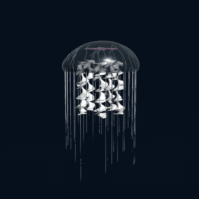

# Procedural Jellyfish

A procedural, animated moon-jellyfish built in Houdini: a pulsing translucent bell with branching veins, four pink gonad rings inside, ruffled oral arms simulated as Vellum cloth, and long tentacles simulated as Vellum hair.

Full video (frames 1–130, 24 fps): [jellyfish.mp4](jellyfish.mp4)

## Breakdown

### Bell
- A **Line** is shaped with two **Bend** nodes (`bend_tip`, `bend_main`), centered with **Match Size**, and spun into a dome with **Revolve**.
- **Fuse** welds the seam, **Attribute Noise** adds subtle lumps, and **Poly Extrude** gives the shell thickness.
- A `Controller` null drives the pulse: its keyframed channels animate the bend angles and the bell's vertical translation in `transform1`.

### Oral Arms
- A **Grid** gets ruffled edges from an **Attribute Wrangle** (`add_ruffle`: a sine wave in z whose amplitude grows toward the edges, plus noise), then is twisted, remeshed, and copied into several arms.
- The arms are attached to the bell with **Point Deform**, then simulated as **Vellum cloth** with their top points pinned to the animation, and cached with **File Cache**.
- A **Normal** node gives the simulated mesh smooth shading.

### Veins
Following the assignment workflow:
1. **Remesh** the rest-pose bell into triangles so the paths are not grid-aligned.
2. An Attribute Wrangle picks 12 root points near the top and 60 tip points spread down the bell; **Find Shortest Path** connects them, with a noise-based cost for more organic branching.
3. Overlapping paths are welded and de-duplicated (**Fuse → Convert Line → Wrangle → PolyPath**), and each branch is made thicker where more paths share it.
4. **Resample → Fuse → Smooth** rounds out the paths while keeping the junctions fixed.
5. The curves are projected back onto the bell surface and given width with **Sweep**.
6. **Point Deform** (rest bell → animated bell) makes the veins follow the pulse.

### Organs
- A **Torus** is squashed into an oval, offset from the center, given organic lumps with **Attribute Noise**, and copied four times around the bell axis with **Copy and Transform**.
- The rings are placed just under the inside of the dome and follow the bell with **Point Deform**.

### Tentacles
Adapted from the Vellum hair tutorial, with the jellyfish's rim in place of a scalp:
1. The bell's rim is found with **Group Create** (unshared edges); every third rim point becomes a root, tucked slightly inside the rim and given a random length.
2. A downward **Line** is copied onto each root, and the first two points of each curve go into a `root` group.
3. The curves move with the bell's roots (roots follow the bell via **Point Deform**).
4. **Vellum Hair** constraints pin the `root` group with *Match Animation*. Low bend stiffness, low gravity, and velocity damping keep the motion soft and underwater-like. The result is cached with **File Cache**.
5. **Sweep** turns the curves into tubes that taper from root to tip.

### Look and Playback
- Each part gets its own color (`Cd`) and viewport transparency (`Alpha`): a translucent blue bell, milky-white arms, pink organs, and pale tentacles. The bell is merged last so the parts inside it stay visible.
- Everything is merged, stripped down to the attributes the viewport needs, and cached once more (`final_cache`) so the viewport plays back in real time.
